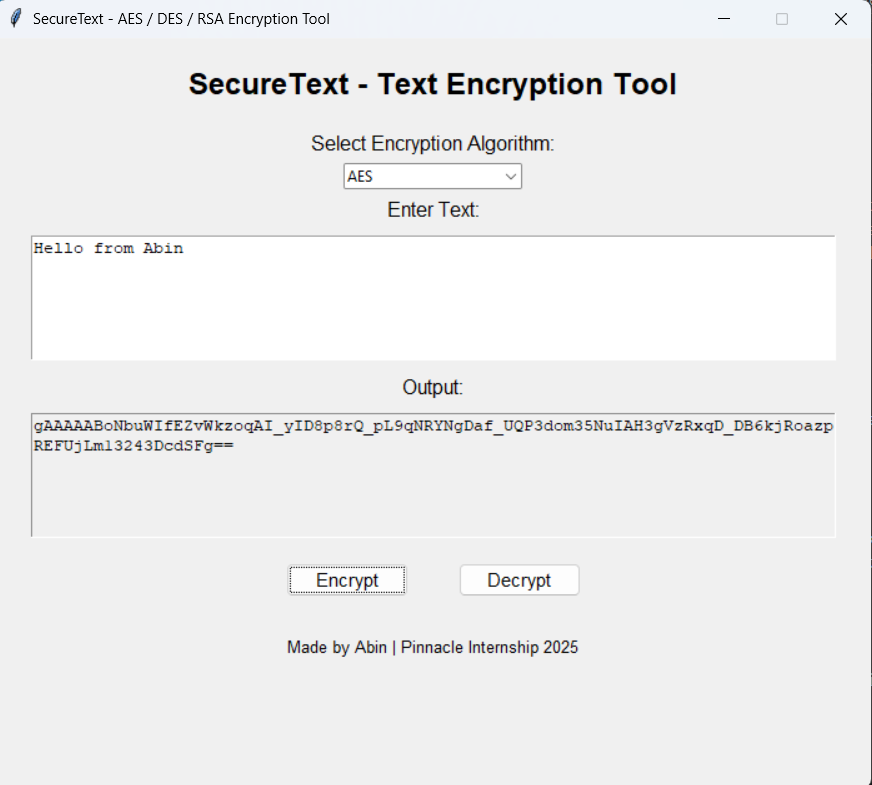
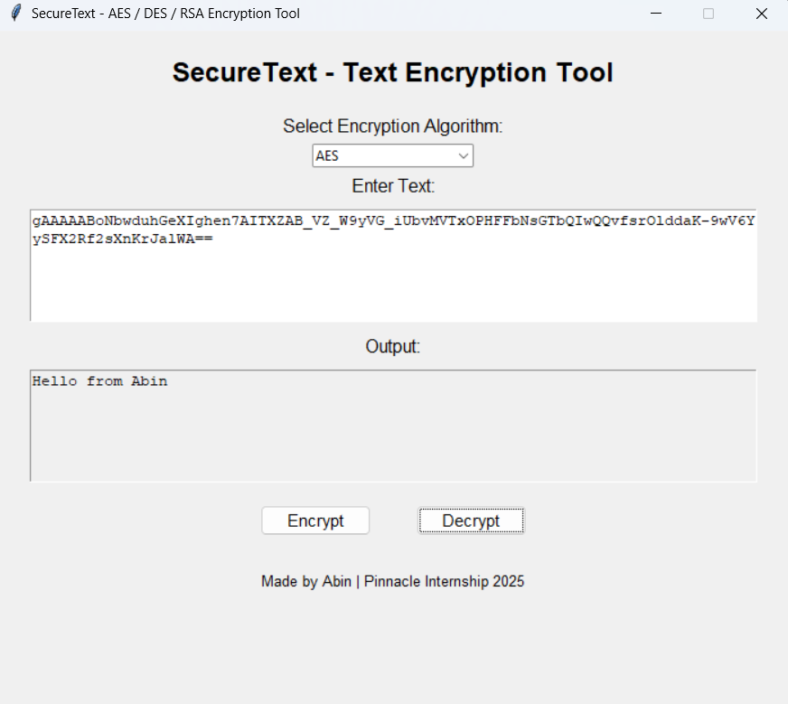
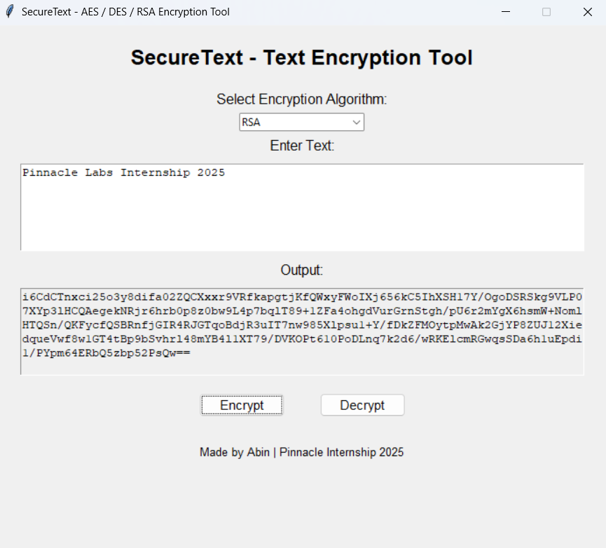
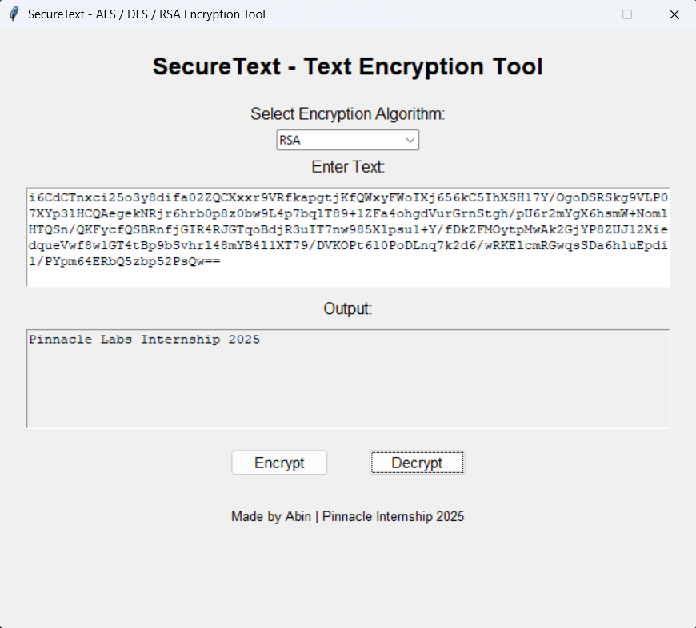

# 🔐 SecureText - Text Encryption Tool using AES, DES, and RSA

A GUI-based Python project that allows users to **encrypt and decrypt text** using three major cryptographic algorithms:
- **AES** (Advanced Encryption Standard)
- **DES** (Data Encryption Standard)
- **RSA** (Rivest–Shamir–Adleman)

> 🧑‍💻 Developed by **Abin Shaji Thomas**  
> 📅 Submitted for **Pinnacle Labs Cybersecurity Internship – Task 1**

---

## 🎯 Task Objective

As part of Task 1 in the Pinnacle Labs Cybersecurity Internship, the goal was to create a cybersecurity project that demonstrates **text encryption using different cryptographic algorithms**, specifically **AES, DES, and RSA**.

This project fulfills that requirement by implementing all three algorithms in a single, user-friendly GUI application built in Python.

---

## ✅ Completed Features

- Full **Tkinter GUI**
- Encryption & decryption using:
  - 🔐 AES (symmetric, 128-bit) 
  - 🔐 DES (symmetric, 56-bit legacy)
  - 🔐 RSA (asymmetric, 2048-bit)
- Key generation and management
- User input/output areas with instant results
- AES and RSA keys are auto-generated and saved securely
- Error handling for invalid or corrupted inputs
- Lightweight and works completely offline

---

## 🧠 What I Learned

Through this task, I gained strong practical knowledge in:

- Implementing and comparing **symmetric vs. asymmetric encryption**
- Working with **Python crypto libraries** like `cryptography` and `pycryptodome`
- Securely handling **keys**, padding, and Base64 encoding
- Building a full **GUI-based desktop application** using Tkinter
- Structuring code cleanly for readability and maintenance
- Understanding how encryption is applied in **real-world cybersecurity**

This project strengthened my understanding of core cryptographic principles and gave me hands-on experience in building functional, offline tools used in secure communication systems.

---

## 📸 Screenshot

### AES Encryption and Decryption

  
  

### RSA Encryption and Decryption

  
  

---

## 📄 Report

A full PDF report has been included that documents the encryption types, usage, code logic, and key learnings.

📎 [Download the Report](./Task1_Report_Abin_Shaji_Thomas.pdf)

---

## 🧑‍💻 Developed By

**Abin Shaji Thomas**  
Cybersecurity Intern – May 2025  
Karunya Institute of Technology and Sciences  
[LinkedIn](https://www.linkedin.com/posts/abin-shaji-thomas_cybersecurity-python-internship-activity-7333159460904816641-TeZa?utm_source=share&utm_medium=member_desktop&rcm=ACoAAFElLGwBJkG1pcIp0cEol0St3SCjiFhf1xg)

---

⚠️ Important: This code is protected by copyright and cannot be used or copied without permission.
> Note: All key files (`.key`, `.pem`) are auto-generated during runtime and are excluded from version control for security reasons.

## ⚠️ Disclaimer

This project is created strictly for **educational purposes** as part of the Pinnacle Labs internship. Encryption must always be used ethically and within legal boundaries.
